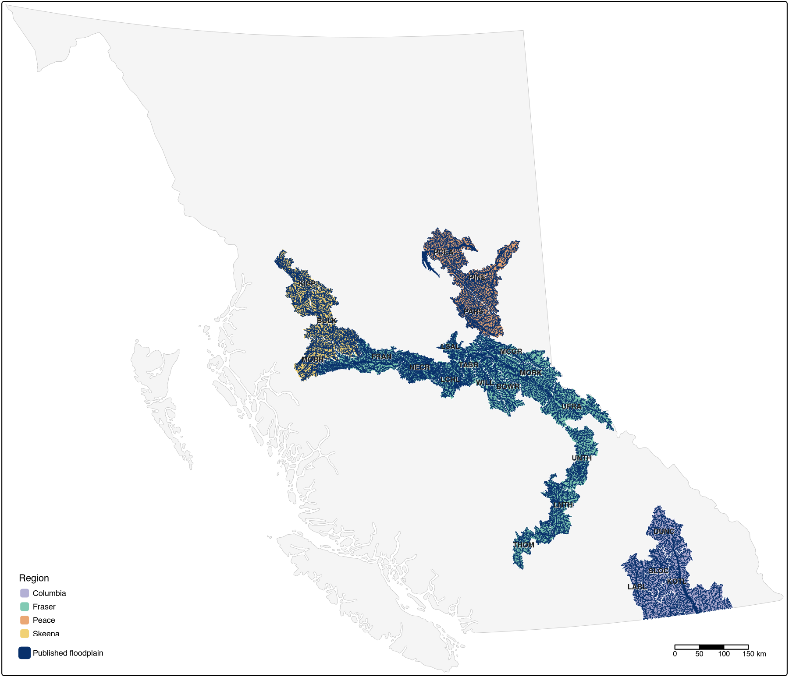
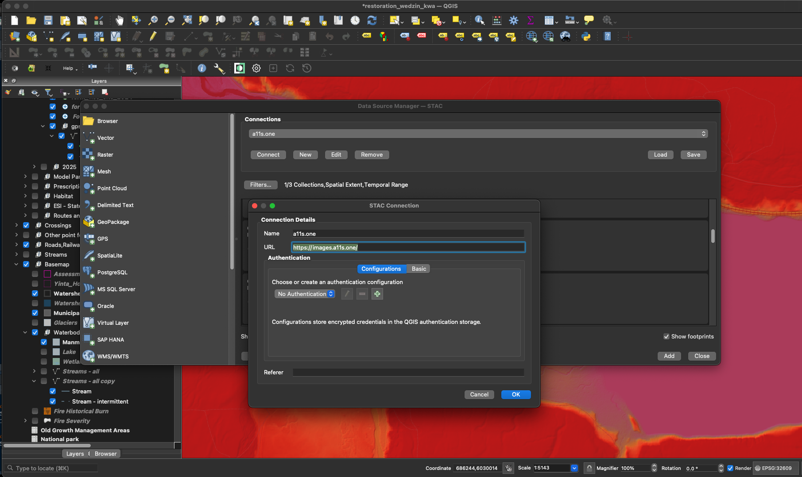
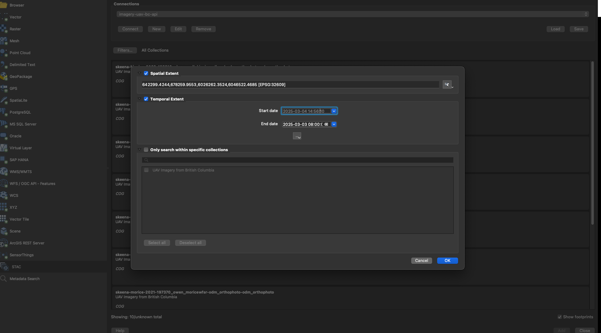

stac-floodplains-bc
================

<!-- README.md is generated from README.Rmd. Please edit that file -->


**`stac-floodplains-bc`** is a catalogue of how land cover changed on British Columbia’s
floodplains between 2017 and 2023 — where trees were lost, where they came back, and over what
extent — for 23 watershed groups in
4 regions. It is published as a
[SpatioTemporal Asset Catalog](https://stacspec.org/) (STAC) — a standard for describing geospatial data so a client can search it by place, time and attribute without downloading anything first. It is for restoration planners, stewardship offices and researchers who want the underlying rasters rather than a summary of them. The endpoint is <https://images.a11s.one>, readable from the [`rstac`](https://brazil-data-cube.github.io/rstac/) R package, QGIS 3.42+, or any other STAC client.



Each watershed group is coloured by region; the dark threads inside them are the published floodplains themselves. An interactive version — click any group for its figures and download links for every asset — is at <https://www.newgraphenvironment.com/stac_floodplains_bc/>.

<br>

## Read this before you use the numbers

**This is a screening and exploration tool, not a validated change-detection product.** The floodplain is DEM-derived, the land cover is a global 10 m product applied to BC valley bottoms, and **neither has been field-validated**. The figures say *where to look*, not what happened on the ground. The two that bite hardest:

- **About two-thirds of detected floodplain tree loss is unattributed** — attribution returns roughly 5% fire / 36% harvest / 62% residual on BULK, 3% / 33% / 64% on KOTL. That residual is *unexplained*, not noise: real removal we cannot source, drought, water-level change, terrain shadow and misclassification have not been separated from one another.
- **Cross-group comparison is not valid yet.** With no treed-area denominator, a group whose floodplain is mostly open water cannot be set against a forested one on hectares lost.

“Tree loss” means pixels leaving the tree class; acquisition timing within a year is unknown and unrecoverable from the source; and despite the `ff` names this is **not** a flood-frequency product. The full list lives with the modelling, in [`floodplains`](https://github.com/NewGraphEnvironment/floodplains) → [Reading the outputs](https://github.com/NewGraphEnvironment/floodplains#reading-the-outputs-experimental) — read it before citing anything here. It is all published openly so it can be interrogated; please do, and file what you find.

## What is in the catalogue

One **item** per watershed group, id `<wsg>_all_ff04` — the floodplain of the group’s whole stream network, at order \>= 2 with no access filter. (`all` is the producer’s token for that network, not a species. The id’s middle slot is a scenario’s species, so a group that modelled a single species again would publish `<wsg>_<species>_ff0N`.) Seven assets each, plus one per classified year — every one downloadable from its group’s popup on the [interactive map](https://www.newgraphenvironment.com/stac_floodplains_bc/):

| asset | what it is |
|----|----|
| `classified_<year>` | land cover in that year, clipped to the floodplain, as a Cloud-Optimized GeoTIFF. Class colours and labels are inside the file, so it opens ready to read |
| `transition_2017_2023` | what each cell changed *from* and *to* between 2017 and 2023 |
| `floodplain` | the delineated floodplain at three flood factors — `ff02`, `ff04` (functional floodplain), `ff06` (valley bottom) |
| `floodplain_landcover` | the classified years and the transition patches as polygons |
| `transition_vector` | the transition patches alone — the change layer without the dissolved classified epochs, which carry most of the bytes |
| `style_classified` `style_floodplain` `style_transition` | QGIS layer styles, also embedded in each GeoPackage so the layers open already coloured |

**The classified year set is a property of the item, not of the collection.** Items modelled on the three-year span carry `classified_2017`, `classified_2020` and `classified_2023`; items re-run on an annual span carry one asset per year across the same window. Read the item’s own asset list rather than assuming a count — `transition_2017_2023` covers the same 2017-to-2023 window either way, so a cross-item comparison of the transition is unaffected.

Every asset publishes `file:checksum` and `file:size`, so you can confirm a download arrived intact and pin which build a figure came from. (A checksum answers *are my bytes current*, not *did the values change* — a re-encode moves every checksum.) Every GeoPackage layer carries `wsg`, `species` and `scenario`, so items merged into one file stay separable by attribute.

**Each item’s GeoPackages hold only that item’s layers.** Merging *N* items therefore gives you *N* copies of the same layer families and nothing retired — no second floodplain model from a target the group no longer publishes. `floodplain.gpkg` is the one place several `scenario` values appear under one item, because the ff02, ff04 and ff06 delineations each record their own flood factor.

**Every item is `ff04`**, the functional floodplain. `floodplain.gpkg` also carries the `ff02` and `ff06` (wider valley bottom) delineations, so compare those inside an item rather than across the catalogue. If a group ever publishes a second flood factor, filter on the `flood_factor` property before comparing or summing groups — an unfiltered aggregate would add different extents together.

## Coverage

*Generated from the live API on 2026-10-15: 23 items across 23 watershed groups in 4 regions (Columbia, Fraser, Peace, Skeena), catalogue version 2.0.0.*

| WSG | Region | Species | Flood factor | Floodplain (km²) | Gross loss (ha) | Gross gain (ha) | Net (ha) |
|:---|:---|:---|:---|---:|---:|---:|---:|
| DUNC | Columbia | whole network | ff04 | 185 | 117 | 214 | +97 |
| KOTL | Columbia | whole network | ff04 | 754 | 643 | 444 | -199 |
| LARL | Columbia | whole network | ff04 | 376 | 379 | 198 | -182 |
| SLOC | Columbia | whole network | ff04 | 154 | 120 | 84 | -36 |
| BOWR | Fraser | whole network | ff04 | 390 | 586 | 466 | -120 |
| FRAN | Fraser | whole network | ff04 | 1,096 | 10,140 | 1,056 | -9,084 |
| LCHL | Fraser | whole network | ff04 | 427 | 1,526 | 2,172 | +646 |
| LNTH | Fraser | whole network | ff04 | 389 | 746 | 489 | -257 |
| LSAL | Fraser | whole network | ff04 | 291 | 1,004 | 1,016 | +13 |
| MCGR | Fraser | whole network | ff04 | 355 | 777 | 1,046 | +269 |
| MORK | Fraser | whole network | ff04 | 667 | 1,063 | 1,408 | +345 |
| NECR | Fraser | whole network | ff04 | 760 | 4,464 | 2,199 | -2,264 |
| TABR | Fraser | whole network | ff04 | 267 | 635 | 426 | -208 |
| THOM | Fraser | whole network | ff04 | 257 | 1,169 | 178 | -991 |
| UFRA | Fraser | whole network | ff04 | 302 | 827 | 907 | +80 |
| UNTH | Fraser | whole network | ff04 | 235 | 673 | 356 | -316 |
| WILL | Fraser | whole network | ff04 | 351 | 679 | 694 | +14 |
| PARS | Peace | whole network | ff04 | 559 | 1,753 | 3,348 | +1,595 |
| PCEA | Peace | whole network | ff04 | 843 | 228 | 225 | -2 |
| PINE | Peace | whole network | ff04 | 489 | 1,033 | 1,627 | +594 |
| BULK | Skeena | whole network | ff04 | 660 | 2,793 | 1,319 | -1,475 |
| KISP | Skeena | whole network | ff04 | 324 | 350 | 1,012 | +662 |
| MORR | Skeena | whole network | ff04 | 479 | 660 | 780 | +121 |
| **Total** |  |  |  | **10,611** | **32,366** | **21,667** | **-10,699** |

Gross loss is area tree-covered in 2017 but not 2023, gross gain the reverse, net is gain minus loss — so a negative number is net tree loss. `Floodplain (km²)` is each item’s **own** extent at its own flood factor, which is why the `Flood factor` column matters. Across the catalogue: **10,611 km²** of floodplain, **32,366 ha** lost, **21,667 ha** gained, **-10,699 ha** net. That km² total counts each group’s `ff04` extent once, so it stays correct if a group ever publishes two items over one physical floodplain, while the tree-change figures sum every item; rows are rounded, so a column need not sum exactly to its unrounded total.

## Query it

``` r
library(rstac)

items <- rstac::stac("https://images.a11s.one/") |>
  rstac::stac_search(collections = "stac-floodplains-bc", limit = 1000) |>
  # add `rstac::ext_query(flood_factor == 6)` for valley-bottom items only. Filter on
  # flood_factor, not scenario: scenario is species-pinned and would miss a future co_ff06.
  rstac::post_request() |>
  rstac::items_fetch()
```

A raster asset streams — no download needed. Paste the `/vsicurl/` path into QGIS’s Add Raster Layer dialog, or read it from the command line. `GDAL_DISABLE_READDIR_ON_OPEN` stops GDAL spending a dozen wasted requests probing for sidecar files that are not there:

``` bash
GDAL_DISABLE_READDIR_ON_OPEN=EMPTY_DIR \
  gdalinfo /vsicurl/https://stac-floodplains-bc.s3.us-west-2.amazonaws.com/kotl_all_ff04/classified_2023.tif
```

### From QGIS, filtered to your area of interest

QGIS 3.42+ speaks STAC natively — Data Source Manager → STAC → New, with the endpoint URL and no authentication:



Then **Filters…** restricts the search to your own area of interest — Spatial Extent takes the current map view or any extent you draw, Temporal Extent a date range — so you get back only the items covering the ground you are working on. The dialog below is shown against a sister collection on the same endpoint; it works identically here.



Lutra Consulting’s [STAC in QGIS post](https://www.lutraconsulting.co.uk/blogs/stac-in-qgis) walks through it in more detail.

## How it is built, and where

**No modelling happens in this repository.** Every number in this catalogue is produced by
[**`floodplains`**](https://github.com/NewGraphEnvironment/floodplains) — the driver repo, and the
place to go for how the model works, what it assumes, and what is still unresolved. This
repository only stages those outputs, converts the rasters to Cloud-Optimized GeoTIFFs, tags them,
uploads them, and registers the STAC collection. If a figure needs recomputing it is fixed there
and republished here. The chain, each link its own repository:

[`fresh`](https://github.com/NewGraphEnvironment/fresh) (stream network) → [`link`](https://github.com/NewGraphEnvironment/link) (habitat interpretation) → [`flooded`](https://github.com/NewGraphEnvironment/flooded) (floodplain delineation) → [`drift`](https://github.com/NewGraphEnvironment/drift) (land-cover change) → [`floodplains`](https://github.com/NewGraphEnvironment/floodplains) (driver) → **this repository** (publish only)

The rebuild and release commands, the guards protecting a bucket with no versioning, and the release recipe are in [`scripts/README.md`](scripts/README.md).

## Credits

Two different debts, and they are not the same thing.

**Method and software this work is built on**

| whose | what | licence |
|----|----|----|
| [Devin Cairns — BlueGeo](https://github.com/bluegeo/bluegeo) | the Valley Confinement Algorithm that `flooded` adapts | MIT |
| [USDA Rocky Mountain Research Station](https://research.fs.usda.gov/rmrs) | the original valley-confinement method — the VCA Toolbox | — |
| [Simon Norris — `bcfishpass`](https://github.com/smnorris/bcfishpass) | lateral habitat assembly, and the modelling approach `link` reproduces | Apache 2.0 (software); its database is ODbL and the contents DbCL |

**Data the published products derive from** — [Impact Observatory](https://planetarycomputer.microsoft.com/api/stac/v1/collections/io-lulc-annual-v02) with Esri and Microsoft (`io-lulc-annual-v02` land cover, CC BY 4.0, via Microsoft Planetary Computer), [Natural Resources Canada](https://datacube.services.geo.ca/stac/api/collections/mrdem-30) (`mrdem-30`, the terrain the floodplains are delineated off, OGL — Canada) and the Province of British Columbia (Freshwater Atlas stream network, OGL — British Columbia). The land cover **was modified**: clipped to modelled floodplain extents and cross-tabulated 2017 against 2023 into transitions. Saying so is a condition of CC BY, which is why the collection’s `sci:citation` says it too.

## Licence

The scripts here are [MIT](LICENSE). The published catalogue — everything under `s3://stac-floodplains-bc` and the collection at `images.a11s.one` — is [CC BY 4.0](https://creativecommons.org/licenses/by/4.0/), published as the collection’s `license` alongside six `providers`, a `rel: license` link and a `sci:citation`. Why that combination is the right one, read from each producer’s own record, is in [`ATTRIBUTION.md`](ATTRIBUTION.md).

## Sister collections on the same endpoint

- [`stac_dem_bc`](https://github.com/NewGraphEnvironment/stac_dem_bc) — LidarBC elevation (`stac-elevation-bc`)
- [`stac_airphoto_bc`](https://github.com/NewGraphEnvironment/stac_airphoto_bc) — historic airphoto thumbnails, 1963–2019 (`stac-airphoto-bc`)
- [`stac_uav_bc`](https://github.com/NewGraphEnvironment/stac_uav_bc) — UAV imagery, organized by watershed (`imagery-uav-bc-prod`)
